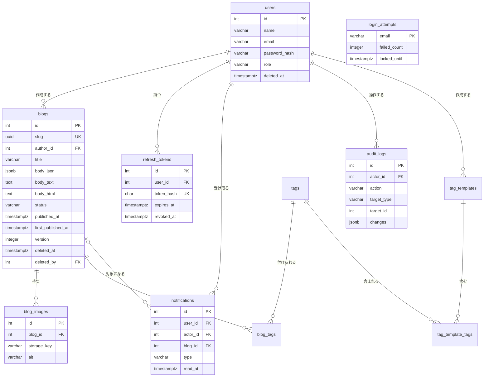

# DB設計書

関連資料：[requirements.md](requirements.md) / [APIdesign.md](APIdesign.md) / [screendesign.md](screendesign.md)

## 目次
1. [共通方針](#1-共通方針)
2. [テーブル一覧](#2-テーブル一覧)
3. [ER図](#3-er図)
4. [テーブル定義](#4-テーブル定義)
5. [主な処理とDBの動き](#5-主な処理とdbの動き)
6. [今後の拡張で追加するテーブル](#6-今後の拡張で追加するテーブル)

---

## 1. 共通方針

| 項目 | 内容 |
|---|---|
| DBMS | PostgreSQL 16（JSONB 型・部分インデックス・UUID 型が使えるため） |
| 文字コード | UTF-8 |
| 命名 | テーブル名は複数形の snake_case、カラム名は snake_case |
| 主キー | `id`（`integer` の自動採番。最大約21億件で、このシステムには十分なため。`bigint` は JavaScript で扱いにくい） |
| 日時 | `timestamptz`（UTCで保存し、APIでJSTに変換して返す） |
| 作成・更新日時 | 全てのテーブルに `created_at` を持つ。更新があるテーブルは `updated_at` も持つ |
| 論理削除 | `deleted_at` に日時が入っていれば削除済み。`users` と `blogs` で使う |
| ステータスなどの区分値 | `varchar` に CHECK 制約をかける（区分を追加しやすくするため、ENUM 型は使わない） |
| 外部キー | 原則として付ける。削除は論理削除で行うため、`ON DELETE` は基本的に `RESTRICT` |
| 拡張機能 | `pg_trgm`（日本語の部分一致検索を速くするため） |
| スキーマ管理 | Prisma（`schema.prisma` と Prisma Migrate）で管理する |
| Prisma で書けないもの | CHECK 制約・部分インデックス（`WHERE` 付きのインデックス）・`pg_trgm` 拡張は `schema.prisma` に書けないため、`prisma migrate dev --create-only` で作ったマイグレーションSQLに手で追記する |
| pg_trgm のインデックス | `schema.prisma` に `@@index(..., type: Gin)` で書く（SQLだけに書くと、次のマイグレーションで Prisma が削除しようとするため） |
| Prisma の命名 | モデル名・フィールド名は camelCase（例：`authorId`）にし、`@map` / `@@map` でDBの snake_case に対応させる |

---

## 2. テーブル一覧

| No | テーブル名 | 論理名 | 概要 | 論理削除 |
|---|---|---|---|---|
| 1 | `users` | ユーザー | 管理者・ユーザーのアカウント | ○ |
| 2 | `blogs` | ブログ | ブログ本体 | ○ |
| 3 | `blog_images` | ブログ画像 | ブログにアップロードした画像 | ✕（物理削除） |
| 4 | `refresh_tokens` | リフレッシュトークン | JWT のリフレッシュトークン | ✕（無効日時で管理） |
| 5 | `login_attempts` | ログイン試行 | ログイン失敗の回数とロック | ✕ |
| 6 | `notifications` | 通知 | ダッシュボードに表示する通知 | ✕ |
| 7 | `audit_logs` | 操作ログ | 管理者が他人のリソースを操作した記録 | ✕（追記のみ） |
| 8 | `tags` | タグ | タグの名前 | ✕ |
| 9 | `blog_tags` | ブログタグ | ブログとタグの紐付け | ✕（ブログ・タグと一緒に削除） |
| 10 | `tag_templates` | タグのテンプレート | よく使うタグの組み合わせ（全員で共有） | ✕ |
| 11 | `tag_template_tags` | テンプレートのタグ | テンプレートとタグの紐付け | ✕（テンプレート・タグと一緒に削除） |

---

## 3. ER図

※ VS Code では「Markdown Preview Mermaid Support」などの拡張機能を入れると、図として表示される。

---

## 4. テーブル定義

凡例：PK = 主キー / FK = 外部キー / UK = ユニーク / NN = NOT NULL

### 4-1. users（ユーザー）

| カラム名 | 型 | PK | FK | UK | NN | 初期値 | 説明 |
|---|---|---|---|---|---|---|---|
| `id` | integer | ○ | | | ○ | 自動採番 | ユーザーID |
| `name` | varchar(50) | | | | ○ | | 表示名 |
| `email` | varchar(255) | | | △ | ○ | | メールアドレス（ログインID）。小文字に揃えて保存する |
| `password_hash` | varchar(255) | | | | ○ | | パスワードのハッシュ（bcrypt） |
| `role` | varchar(10) | | | | ○ | `'user'` | `admin` / `user` |
| `avatar_storage_key` | varchar(255) | | | | | NULL | アイコン画像の保存先（256×256 の WebP）。未設定なら名前の1文字目を表示する |
| `created_at` | timestamptz | | | | ○ | 現在日時 | 作成日時 |
| `updated_at` | timestamptz | | | | ○ | 現在日時 | 更新日時 |
| `deleted_at` | timestamptz | | | | | NULL | 削除日時（論理削除） |

△：削除されていないユーザーの中でのみユニーク（部分ユニークインデックス）

| 制約・インデックス | 内容 | 目的 |
|---|---|---|
| CHECK | `role IN ('admin', 'user')` | 不正なロールを防ぐ |
| 部分ユニークインデックス | `email` WHERE `deleted_at IS NULL` | 削除したユーザーと同じメールアドレスで、新しくユーザーを作れるようにする |

### 4-2. blogs（ブログ）

| カラム名 | 型 | PK | FK | UK | NN | 初期値 | 説明 |
|---|---|---|---|---|---|---|---|
| `id` | integer | ○ | | | ○ | 自動採番 | ブログID（管理画面で使う） |
| `slug` | uuid | | | ○ | ○ | 自動生成 | URL用の識別子（`/blog/{slug}`）。変更不可 |
| `author_id` | integer | | users | | ○ | | 作者 |
| `title` | varchar(100) | | | | ○ | | タイトル |
| `body_json` | jsonb | | | | ○ | 空のドキュメント | 本文（TipTap の JSON） |
| `body_text` | text | | | | ○ | `''` | 本文のテキストのみ（検索・抜粋用）。保存時に `body_json` から生成する |
| `body_html` | text | | | | ○ | `''` | 表示用のHTML（サニタイズ済み）。保存時に `body_json` から生成する |
| `thumbnail_image_id` | integer | | blog_images | | | NULL | 一覧に表示するサムネイル（本文中の1枚目の画像）。保存時に設定する |
| `status` | varchar(10) | | | | ○ | `'draft'` | `draft` / `scheduled` / `private` / `public` |
| `published_at` | timestamptz | | | | | NULL | 公開日時（公開予定のときは予定日時） |
| `first_published_at` | timestamptz | | | | | NULL | 初めて公開した日時 |
| `version` | integer | | | | ○ | 1 | 楽観的ロック用。更新のたびに +1 |
| `created_at` | timestamptz | | | | ○ | 現在日時 | 作成日時 |
| `updated_at` | timestamptz | | | | ○ | 現在日時 | 更新日時 |
| `deleted_at` | timestamptz | | | | | NULL | 削除日時（論理削除） |
| `deleted_by` | integer | | users | | | NULL | 削除した人 |

| 制約・インデックス | 内容 | 目的 |
|---|---|---|
| CHECK | `status IN ('draft', 'scheduled', 'private', 'public')` | 不正なステータスを防ぐ |
| CHECK | `status <> 'scheduled' OR published_at IS NOT NULL` | 公開予定には公開日時を必須にする |
| インデックス | `(status, published_at DESC)` WHERE `deleted_at IS NULL` | 公開一覧の取得を速くする |
| インデックス | `(author_id, updated_at DESC)` WHERE `deleted_at IS NULL` | 管理画面の自分のブログ一覧を速くする |
| インデックス | `(deleted_at DESC)` WHERE `deleted_at IS NOT NULL` | 削除一覧を速くする |
| インデックス | `(status, published_at)` WHERE `status = 'scheduled'` | 定期バッチで公開予定を探すのを速くする |
| GIN インデックス（pg_trgm） | `title`、`body_text` | キーワードの部分一致検索を速くする |

**`body_html` をDBに保存する理由**

| 理由 |
|---|
| 公開中のブログは編集できないため、保存時に一度だけ変換すればよい |
| 閲覧のたびに JSON から HTML へ変換しなくて済み、表示が速くなる |
| サニタイズのルールを変えたときは、バッチで全てのブログの `body_html` を作り直す |

### 4-3. blog_images（ブログ画像）

| カラム名 | 型 | PK | FK | UK | NN | 初期値 | 説明 |
|---|---|---|---|---|---|---|---|
| `id` | integer | ○ | | | ○ | 自動採番 | 画像ID（本文 JSON の `image_id` と対応する） |
| `blog_id` | integer | | blogs | | ○ | | どのブログの画像か |
| `storage_key` | varchar(255) | | | ○ | ○ | | 保存先のパス（例：`blogs/12/xxxx.webp`） |
| `alt` | varchar(200) | | | | ○ | `''` | 代替テキスト |
| `width` | integer | | | | ○ | | 変換後の幅（px） |
| `height` | integer | | | | ○ | | 変換後の高さ（px） |
| `file_size` | integer | | | | ○ | | 変換後のファイルサイズ（バイト） |
| `original_filename` | varchar(255) | | | | ○ | | アップロードしたときのファイル名 |
| `uploaded_by` | integer | | users | | ○ | | アップロードした人 |
| `created_at` | timestamptz | | | | ○ | 現在日時 | 作成日時 |

| 制約・インデックス | 内容 | 目的 |
|---|---|---|
| ユニーク | `storage_key` | 同じファイルを二重に登録しない |
| インデックス | `blog_id` | ブログの画像一覧・枚数チェックを速くする |

| 補足 |
|---|
| 画像URLは DB に保存せず、`画像配信のベースURL + storage_key` で組み立てる（配信先を変えてもDBを直さずに済む） |
| 画像の並び順は本文 JSON の中の位置で決まるため、並び順のカラムは持たない |
| `alt` は、ブログの保存時に本文 JSON の値で更新する |
| 本文で使われていない画像（アップロードしたが使わなかった画像、エディタから取り除いた画像）は、定期バッチで削除する（アップロードから24時間以上経っているもの） |
| 削除一覧にあるブログの画像は、本文で使われているため削除されない |

### 4-4. refresh_tokens（リフレッシュトークン）

| カラム名 | 型 | PK | FK | UK | NN | 初期値 | 説明 |
|---|---|---|---|---|---|---|---|
| `id` | integer | ○ | | | ○ | 自動採番 | ID |
| `user_id` | integer | | users | | ○ | | トークンの持ち主 |
| `token_hash` | char(64) | | | ○ | ○ | | トークンの SHA-256 ハッシュ（トークンそのものは保存しない） |
| `expires_at` | timestamptz | | | | ○ | | 有効期限 |
| `revoked_at` | timestamptz | | | | | NULL | 無効にした日時 |
| `replaced_by_id` | integer | | refresh_tokens | | | NULL | 入れ替えた後の新しいトークン |
| `user_agent` | varchar(500) | | | | | NULL | 発行したときのブラウザ |
| `ip_address` | inet | | | | | NULL | 発行したときのIPアドレス |
| `created_at` | timestamptz | | | | ○ | 現在日時 | 発行日時 |

| 制約・インデックス | 内容 | 目的 |
|---|---|---|
| ユニーク | `token_hash` | トークンを検索する |
| インデックス | `user_id` WHERE `revoked_at IS NULL` | ユーザーの有効なトークンを一括で無効にする |

| 補足 |
|---|
| 無効にしたトークンが再び使われた場合は、盗まれた可能性があるため、そのユーザーの全てのトークンを無効にする |
| 期限が切れたトークンは、定期バッチで削除する |

### 4-5. login_attempts（ログイン試行）

| カラム名 | 型 | PK | FK | UK | NN | 初期値 | 説明 |
|---|---|---|---|---|---|---|---|
| `email` | varchar(255) | ○ | | | ○ | | ログインに使われたメールアドレス（小文字に揃える） |
| `failed_count` | integer | | | | ○ | 0 | 連続で失敗した回数 |
| `locked_until` | timestamptz | | | | | NULL | この日時までログインを受け付けない |
| `updated_at` | timestamptz | | | | ○ | 現在日時 | 最後に失敗した日時 |

| 補足 |
|---|
| `users` とは別のテーブルにしている。存在しないメールアドレスでも同じように回数を数えることで、「このメールアドレスは登録されているか」を外から判別できないようにするため |
| ログインに成功したら、その行を削除する（失敗回数のリセット） |

### 4-6. notifications（通知）

| カラム名 | 型 | PK | FK | UK | NN | 初期値 | 説明 |
|---|---|---|---|---|---|---|---|
| `id` | integer | ○ | | | ○ | 自動採番 | 通知ID |
| `user_id` | integer | | users | | ○ | | 通知を受け取る人（作者） |
| `actor_id` | integer | | users | | ○ | | 操作した人（管理者） |
| `blog_id` | integer | | blogs | | | NULL | 対象のブログ（パスワードリセットの場合は NULL） |
| `type` | varchar(50) | | | | ○ | | 通知の種類（APIdesign.md 7-4） |
| `message` | varchar(255) | | | | ○ | | 表示する文章。通知を作った時点の内容で保存する |
| `read_at` | timestamptz | | | | | NULL | 既読日時 |
| `created_at` | timestamptz | | | | ○ | 現在日時 | 通知日時 |

| 制約・インデックス | 内容 | 目的 |
|---|---|---|
| CHECK | `type IN ('blog_updated_by_admin', 'blog_status_changed_by_admin', 'blog_deleted_by_admin', 'blog_restored_by_admin', 'blog_images_changed_by_admin', 'password_reset_by_admin')` | 不正な種類を防ぐ |
| インデックス | `(user_id, created_at DESC)` | 自分宛ての通知一覧を速くする |
| インデックス | `user_id` WHERE `read_at IS NULL` | 未読の件数を速く数える |

| 補足 |
|---|
| `message` を保存しておくのは、後でブログのタイトルが変わっても、通知した時点の内容を残すため |

### 4-7. audit_logs（操作ログ）

| カラム名 | 型 | PK | FK | UK | NN | 初期値 | 説明 |
|---|---|---|---|---|---|---|---|
| `id` | integer | ○ | | | ○ | 自動採番 | ログID |
| `actor_id` | integer | | users | | ○ | | 操作した人 |
| `action` | varchar(50) | | | | ○ | | 操作の種類（例：`blog.update`、`blog.status_change`、`blog.delete`、`blog.restore`、`blog.image_add`、`user.update`、`user.delete`、`user.password_reset`） |
| `target_type` | varchar(20) | | | | ○ | | 対象の種類（`blog` / `user`） |
| `target_id` | integer | | | | ○ | | 対象のID |
| `changes` | jsonb | | | | | NULL | 変更前後の値（例：`{"status": {"before": "public", "after": "private"}}`） |
| `ip_address` | inet | | | | | NULL | 操作したIPアドレス |
| `user_agent` | varchar(500) | | | | | NULL | 操作したブラウザ |
| `created_at` | timestamptz | | | | ○ | 現在日時 | 操作日時 |

| 制約・インデックス | 内容 | 目的 |
|---|---|---|
| インデックス | `(target_type, target_id, created_at DESC)` | 特定のブログ・ユーザーの操作履歴を調べる |
| インデックス | `(actor_id, created_at DESC)` | 特定の管理者の操作履歴を調べる |

| 補足 |
|---|
| `target_id` には外部キーを付けない（対象がブログとユーザーの2種類あるため） |
| 追記のみで、更新・削除はしない |
| 本文 JSON は大きいため、`changes` には本文の中身ではなく「本文を変更した」ことだけを記録する |

---

### 4-8. tags（タグ）

| カラム名 | 型 | PK | FK | UK | NN | 初期値 | 説明 |
|---|---|---|---|---|---|---|---|
| `id` | integer | ○ | | | ○ | 自動採番 | タグID |
| `name` | varchar(30) | | | ○ | ○ | | タグ名（全角英数字は半角に、先頭の「#」は取り除いて保存する） |
| `created_at` | timestamptz | | | | ○ | 現在日時 | 作成日時 |

| 補足 |
|---|
| 大文字・小文字の違いは同じタグとして扱う。保存時に既存のタグを大文字・小文字を区別せずに探し、あればそれを使う |

### 4-9. blog_tags（ブログタグ）

| カラム名 | 型 | PK | FK | UK | NN | 初期値 | 説明 |
|---|---|---|---|---|---|---|---|
| `blog_id` | integer | ○ | blogs | | ○ | | ブログ |
| `tag_id` | integer | ○ | tags | | ○ | | タグ |
| `position` | integer | | | | ○ | 0 | 表示順（付けた順） |

| 制約・インデックス | 内容 | 目的 |
|---|---|---|
| 主キー | `(blog_id, tag_id)` | 同じタグを二重に付けない |
| インデックス | `tag_id` | タグでの絞り込みを速くする |
| 外部キー | `ON DELETE CASCADE` | 紐付けだけのテーブルのため、ブログ・タグと一緒に削除する |

### 4-10. tag_templates（タグのテンプレート）

| カラム名 | 型 | PK | FK | UK | NN | 初期値 | 説明 |
|---|---|---|---|---|---|---|---|
| `id` | integer | ○ | | | ○ | 自動採番 | テンプレートID |
| `name` | varchar(50) | | | | ○ | | テンプレート名 |
| `created_by` | integer | | users | | ○ | | 作った人（編集・削除できるのは本人と管理者） |
| `created_at` | timestamptz | | | | ○ | 現在日時 | 作成日時 |
| `updated_at` | timestamptz | | | | ○ | 現在日時 | 更新日時 |

### 4-11. tag_template_tags（テンプレートのタグ）

| カラム名 | 型 | PK | FK | UK | NN | 初期値 | 説明 |
|---|---|---|---|---|---|---|---|
| `template_id` | integer | ○ | tag_templates | | ○ | | テンプレート（削除したら一緒に削除） |
| `tag_id` | integer | ○ | tags | | ○ | | タグ（タグを削除したらテンプレートからも外れる） |
| `position` | integer | | | | ○ | 0 | 表示順（登録した順） |

| 補足 |
|---|
| `audit_logs.target_type` に `tag`・`tag_template` を追加。タグの作成・名前変更・削除は全員の記事に影響するため、誰が操作しても記録する。テンプレートは管理者が他人のものを操作したときに記録する |

---

## 5. 主な処理とDBの動き

### 5-1. ブログの公開・ステータス変更

| 操作 | 更新するカラム |
|---|---|
| 公開（初回） | `status = 'public'`、`published_at = 現在日時`、`first_published_at = 現在日時` |
| 公開（非公開から再公開） | `status = 'public'`（`published_at` はそのまま） |
| 公開予定にする | `status = 'scheduled'`、`published_at = 指定日時` |
| 非公開にする | `status = 'private'` |
| 全ての変更 | `version = version + 1`、`updated_at = 現在日時` |

### 5-2. 公開予定の自動公開

| 方法 | 内容 |
|---|---|
| 取得時の判定 | 公開API・管理API（一覧の絞り込み・ダッシュボードの件数を含む）では `status = 'public' OR (status = 'scheduled' AND published_at <= 現在日時)` を公開中として扱う |
| 定期バッチ（毎分） | `status = 'scheduled' AND published_at <= 現在日時` のブログを、`status = 'public'`、`first_published_at = COALESCE(first_published_at, published_at)` に更新する |
| 操作時 | 公開日時を過ぎた `scheduled` のブログに編集・ステータス変更・削除・画像アップロードの操作が来た場合は、先に上の定期バッチと同じ更新をしてから、ルールを判定する |

### 5-3. 楽観的ロック

| 順番 | 処理 |
|---|---|
| 1 | 画面で開いたときの `version` を、更新リクエストに含めて送る |
| 2 | `UPDATE blogs SET ..., version = version + 1 WHERE id = ? AND version = ?` を実行する |
| 3 | 更新件数が0件なら、他の人が先に更新しているため 409 `VERSION_CONFLICT` を返す |

### 5-4. ブログの削除・復活

| 操作 | 更新するカラム |
|---|---|
| 削除 | `deleted_at = 現在日時`、`deleted_by = 操作者` |
| 復活 | `deleted_at = NULL`、`deleted_by = NULL`、`status` は `first_published_at` があれば `private`、なければ `draft` |
| 復活できない条件 | 作者の `users.deleted_at` が NULL でない |

### 5-5. ユーザーの削除（1つのトランザクションで行う）

| 順番 | 処理 |
|---|---|
| 1 | 管理者を削除する場合は、残りの管理者数を `SELECT ... FOR UPDATE` でロックして数える。0人になるなら中止する |
| 2 | `users.deleted_at = 現在日時` |
| 3 | そのユーザーの、削除されていないブログを全て `deleted_at = 現在日時`、`deleted_by = 操作者` にする |
| 4 | そのユーザーの有効な `refresh_tokens` を全て `revoked_at = 現在日時` にする |
| 5 | 管理者が他人を削除した場合は `audit_logs` に記録する |

### 5-6. 定期バッチ一覧

| バッチ | 間隔 | 処理 |
|---|---|---|
| 公開予定の公開 | 毎分 | 5-2 の更新 |
| 未使用画像の削除 | 1日1回 | 本文で使われておらず、アップロードから24時間以上経った画像のレコードとファイルを削除する |
| 期限切れトークンの削除 | 1日1回 | `expires_at` を過ぎた `refresh_tokens` を削除する |
| ログイン試行の掃除 | 1日1回 | `updated_at` から1日以上経った `login_attempts` を削除する |

---

## 6. 今後の拡張で追加するテーブル

初期リリースでは作らない。今の設計で拡張しやすいことの確認用。

| 拡張機能 | 追加するテーブル・カラム | 今の設計との関係 |
|---|---|---|
| いいね | `blog_likes`（`blog_id`、閲覧者の識別子、`created_at`） | ブログを非公開にしても行を消さないため、いいね数は維持される |
| コメント | `comments`（`blog_id`、名前、本文、`created_at`、`deleted_at`） | 同上 |
| シェア | テーブルは不要 | `slug` が変わらないため、URLが維持される |
| 予約投稿の拡張 | 必要に応じて追加 | 公開予定の仕組みは初期リリースで作り済み |
| おすすめ表示 | `blogs` に `is_featured` などを追加、または閲覧数のテーブル | |
| 限定公開 | `blogs.status` に `unlisted` を追加 | CHECK 制約の変更だけで済む |
