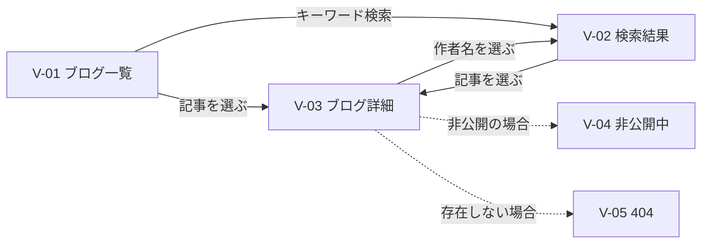
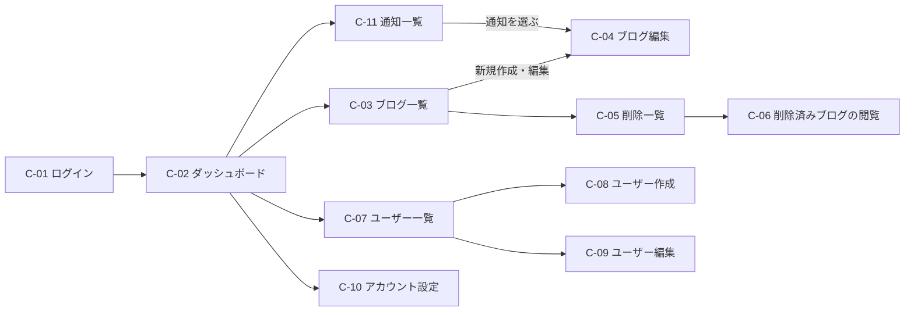

# 画面設計書

関連資料：[requirements.md](requirements.md) / [APIdesign.md](APIdesign.md) / [DBdesign.md](DBdesign.md)

## 目次
1. [共通方針](#1-共通方針)
2. [画面一覧](#2-画面一覧)
3. [画面遷移](#3-画面遷移)
4. [閲覧側の画面](#4-閲覧側の画面)
5. [管理側（CMS）の画面](#5-管理側cmsの画面)
6. [共通部品](#6-共通部品)
7. [メッセージ一覧](#7-メッセージ一覧)
8. [決定事項](#8-決定事項)

---

## 1. 共通方針

### 1-1. 基本

| 項目 | 内容 |
|---|---|
| 言語 | 日本語のみ |
| 閲覧側のURL | `/`、`/search`、`/blog/{slug}` |
| 管理側のURL | `/cms/*` |
| 管理側の検索エンジン対策 | 全ての `/cms/*` に `<meta name="robots" content="noindex">` を付ける |
| リッチエディタ | TipTap（無料の拡張機能のみ） |

### 1-2. レスポンシブ

| 区分 | 画面幅 | 閲覧側 | 管理側 |
|---|---|---|---|
| スマートフォン | 767px以下 | 1列表示 | サイドメニューをハンバーガーメニューにする。一覧はカード表示 |
| タブレット | 768px〜1023px | 2列表示 | サイドメニューをハンバーガーメニューにする。一覧は表形式 |
| PC | 1024px以上 | 3列表示 | サイドメニューを常に表示する。一覧は表形式 |

### 1-3. 表示形式

| 項目 | 閲覧側 | 管理側 |
|---|---|---|
| 日付 | `2026年10月14日` | `2026/10/14 10:00` |
| 1ページの件数 | 12件 | 20件 |

### 1-4. ステータスの表示

| ステータス | 表示名 | 色 |
|---|---|---|
| `draft` | 下書き | グレー |
| `scheduled` | 公開予定 | 青 |
| `public` | 公開中 | 緑 |
| `private` | 非公開 | オレンジ |
| （削除済み） | 削除済み | 赤 |

### 1-5. ログイン状態の扱い（管理側）

| 状況 | 動き |
|---|---|
| ページを開いたとき | A-2（トークン再発行）でアクセストークンを取得する。失敗したらログイン画面へ移動する |
| APIが 401 を返したとき | A-2 で再発行してから、同じAPIをもう一度呼ぶ。再発行も失敗したらログイン画面へ移動する |
| ログイン画面へ移動するとき | 元の画面のURLを覚えておき、ログイン後にその画面へ戻す |
| 権限がない画面を開いたとき | 403画面を表示する（例：ユーザーがユーザー一覧を開いた） |

---

## 2. 画面一覧

### 2-1. 閲覧側

| ID | 画面名 | URL | 使うAPI |
|---|---|---|---|
| V-01 | ブログ一覧（トップ） | `/` | P-1 |
| V-02 | ブログ検索結果 | `/search?q={キーワード}&author_id={作者ID}` | P-1 |
| V-03 | ブログ詳細 | `/blog/{slug}` | P-2 |
| V-04 | 非公開中 | `/blog/{slug}`（P-2 が 403 `BLOG_PRIVATE` のとき） | P-2 |
| V-05 | 404（ページが見つかりません） | 存在しないURL | - |
| V-06 | 500（エラー） | - | - |

### 2-2. 管理側（CMS）

| ID | 画面名 | URL | 管理者 | ユーザー | 使うAPI |
|---|---|---|---|---|---|
| C-01 | ログイン | `/cms/login` | ○ | ○ | A-1 |
| C-02 | ダッシュボード | `/cms` | ○ | ○ | D-1、D-2 |
| C-03 | ブログ一覧 | `/cms/blogs` | 全件 | 自分のみ | B-1、B-2、U-1（管理者の作者絞り込み用） |
| C-04 | ブログ編集 | `/cms/blogs/{id}/edit` | ○ | 自分のみ | B-3〜B-6、B-9 |
| C-05 | 削除一覧 | `/cms/blogs/trash` | 全件 | 自分のみ | B-7、B-8、U-1（管理者の作者絞り込み用） |
| C-06 | 削除済みブログの閲覧 | `/cms/blogs/trash/{id}` | ○ | 自分のみ | B-3、B-8 |
| C-07 | ユーザー一覧 | `/cms/users` | ○ | ✕ | U-1 |
| C-08 | ユーザー作成 | `/cms/users/new` | ○ | ✕ | U-2 |
| C-09 | ユーザー編集（管理者用） | `/cms/users/{id}/edit` | ○ | ✕ | U-3、U-4、U-6、U-7 |
| C-10 | アカウント設定（本人用） | `/cms/account` | ○ | ○ | A-4、U-4、U-5、U-7 |
| C-11 | 通知一覧 | `/cms/notifications` | ○ | ○ | D-2〜D-4 |
| C-12 | 403（権限がありません） | - | ○ | ○ | - |

| 補足 |
|---|
| ブログの「作成画面」は用意しない。C-03 の「新規作成」ボタンを押すと、タイトル「無題の記事」の下書きを作成し、すぐに C-04 を開く。画像のアップロードにはブログIDが必要なため、最初に下書きを作っておく |
| 管理者が自分の情報を変えるときも、C-10 を使う |

---

## 3. 画面遷移

### 3-1. 閲覧側



### 3-2. 管理側



※ C-07〜C-09 は管理者のみ。サイドメニューからは全ての画面に移動できる。

---

## 4. 閲覧側の画面

### 4-0. 共通レイアウト

```
┌──────────────────────────────────────────┐
│ サイト名                   [🔍 検索ボックス] │ ← ヘッダー
├──────────────────────────────────────────┤
│                                          │
│                 メイン                    │
│                                          │
├──────────────────────────────────────────┤
│ © サイト名                                │ ← フッター
└──────────────────────────────────────────┘
```

| 部品 | 内容 |
|---|---|
| サイト名 | 押すと V-01 へ移動する |
| 検索ボックス | Enter で V-02 へ移動する。スマートフォンでは虫眼鏡アイコンを押すと開く |

### V-01. ブログ一覧（トップ）

```
PC（3列）
┌────────────┐ ┌────────────┐ ┌────────────┐
│ [サムネイル] │ │ [サムネイル] │ │ [サムネイル] │
│ タイトル     │ │ タイトル     │ │ タイトル     │
│ 抜粋...      │ │ 抜粋...      │ │ 抜粋...      │
│ 作者・公開日 │ │ 作者・公開日 │ │ 作者・公開日 │
└────────────┘ └────────────┘ └────────────┘
            ‹ 1 2 3 … 10 ›
```

| 項目 | 内容 | APIの項目 |
|---|---|---|
| サムネイル | 画像がない場合は、共通のダミー画像を表示する | `thumbnail_url` |
| タイトル | 2行を超える部分は「…」で省略する | `title` |
| 抜粋 | 3行を超える部分は「…」で省略する | `excerpt` |
| 作者 | 押すと、その作者で絞り込んだ V-02 へ移動する | `author.name` |
| 公開日 | 例：2026年10月14日 | `published_at` |
| ページング | 12件ずつ。URLに `?page=2` を付ける | `meta` |

| 動き |
|---|
| カード全体を押すと V-03 へ移動する |
| ブログが0件の場合は「まだ記事がありません」と表示する |

### V-02. ブログ検索結果

```
「沖縄」の検索結果：15件
┌────────────┐ ┌────────────┐ ┌────────────┐
│  V-01 と同じカード                         │
└────────────┘ └────────────┘ └────────────┘
```

| 項目 | 内容 |
|---|---|
| 見出し | キーワード検索：「{キーワード}」の検索結果：{件数}件 / 作者で絞り込み：「{作者名}」の記事：{件数}件 |
| 一覧 | V-01 と同じ |
| 0件のとき | 「該当する記事が見つかりませんでした」と表示する（作者で絞り込んで0件の場合は、作者名の見出しを出さない） |

### V-03. ブログ詳細

```
┌──────────────────────────────────┐
│ タイトル（h1）                    │
│ 作者名 ・ 2026年10月14日 公開       │
│ （更新：2026年10月20日）            │
├──────────────────────────────────┤
│ 本文（見出し・段落・画像など）       │
│                                  │
│ [画像]                            │
│                                  │
├──────────────────────────────────┤
│ ‹ 一覧へ戻る                       │
└──────────────────────────────────┘
```

| 項目 | 内容 | APIの項目 |
|---|---|---|
| タイトル | h1 で表示する | `title` |
| 作者 | 押すと、その作者で絞り込んだ V-02 へ移動する | `author.name` |
| 公開日 | 例：2026年10月14日 公開 | `published_at` |
| 更新日 | 公開日と違う日の場合だけ表示する | `updated_at` |
| 本文 | APIが返すHTMLをそのまま表示する（サニタイズ済み） | `body_html` |
| 画像 | 遅延読み込み（`loading="lazy"`）にする。表示がずれないよう幅・高さを指定する | `images[]` |

**ページのメタ情報**（検索エンジン・今後のシェア機能のため）

| タグ | 内容 |
|---|---|
| `<title>` | {タイトル} - {サイト名} |
| `description` / `og:description` | 抜粋 |
| `og:title` | タイトル |
| `og:image` | 本文中の1枚目の画像（ない場合はサイト共通の画像） |
| `og:url` | `https://{ドメイン}/blog/{slug}` |

### V-04. 非公開中

```
┌──────────────────────────────────┐
│                                  │
│   このブログは現在非公開中です       │
│   公開されるまでお待ちください       │
│                                  │
│        [ トップへ戻る ]            │
└──────────────────────────────────┘
```

| 項目 | 内容 |
|---|---|
| URL | `/blog/{slug}` のまま変えない（シェアされたURLを維持するため） |
| HTTPステータス | 403 |
| 検索エンジン | `noindex` を付ける |

### V-05. 404 ／ V-06. 500

| 画面 | メッセージ | ボタン |
|---|---|---|
| V-05 | お探しのページは見つかりませんでした | トップへ戻る |
| V-06 | エラーが発生しました。時間をおいて再度お試しください | トップへ戻る |

---

## 5. 管理側（CMS）の画面

### 5-0. 共通レイアウト

```
PC
┌──────────────┬───────────────────────────────┐
│ CMS          │ 🔔3   山田太郎 ▼                │ ← ヘッダー
├──────────────┼───────────────────────────────┤
│ ダッシュボード │                               │
│ ブログ一覧    │                               │
│ 削除一覧      │           メイン               │
│ ユーザー一覧※ │                               │
│ 通知         │                               │
└──────────────┴───────────────────────────────┘
※ 管理者のみ表示
```

| 部品 | 内容 |
|---|---|
| 🔔（通知アイコン） | 未読件数を表示する。押すと C-11 へ移動する |
| ユーザー名 ▼ | 「アカウント設定（C-10）」「ログアウト」を表示する |
| サイドメニュー | 開いている画面を強調表示する。スマートフォン・タブレットではハンバーガーメニューにする |
| ログアウト | A-3 を呼んで C-01 へ移動する |

### C-01. ログイン

```
┌──────────────────────────┐
│          CMS ログイン      │
│ メールアドレス              │
│ [                      ] │
│ パスワード                 │
│ [                  👁 ] │
│                          │
│      [ ログイン ]          │
│ ※パスワードを忘れた場合は    │
│   管理者に連絡してください   │
└──────────────────────────┘
```

| 項目 | 必須 | 内容 |
|---|---|---|
| メールアドレス | ○ | メールアドレスの形式かを画面でもチェックする |
| パスワード | ○ | 👁 を押すと、入力した文字を表示・非表示に切り替える |
| ログインボタン | | 押したらボタンを無効にし、二重送信を防ぐ |

| 結果 | 動き |
|---|---|
| 成功 | 元の画面（なければ C-02）へ移動する |
| 401 | 「メールアドレスまたはパスワードが正しくありません」 |
| 429 | 「ログインの失敗が続いたため、一時的にロックしています。しばらくしてから再度お試しください」 |

### C-02. ダッシュボード

```
┌────────┐┌────────┐┌────────┐┌────────┐┌────────┐
│ 下書き   ││ 公開予定 ││ 公開中   ││ 非公開   ││ 削除済み │
│   2    ││   1    ││   9    ││   0    ││   1    │
└────────┘└────────┘└────────┘└────────┘└────────┘
                                     [ ＋ 新規作成 ]
┌─ 未読の通知 ──────────────┐ ┌─ 最近更新したブログ ─────┐
│ ● 管理者 佐藤 があなたの…  │ │ 沖縄旅行記    公開中      │
│ ● …                     │ │ …                      │
│        すべて見る ›       │ │        すべて見る ›      │
└──────────────────────────┘ └────────────────────────┘
```

| 項目 | 内容 | APIの項目 |
|---|---|---|
| 件数カード | ステータスごとの件数。押すと、そのステータスで絞り込んだ C-03（削除済みは C-05）へ移動する | `blog_counts` |
| 新規作成 | C-03 の新規作成と同じ動き | - |
| 未読の通知 | 未読の通知を最大5件表示する。押したときの動きは C-11 と同じ | D-2（`unread_only=true`） |
| 最近更新したブログ | 5件表示する。押すと C-04 へ移動する | `recent_blogs` |

| 補足 |
|---|
| 管理者の件数カードは、全てのユーザーのブログを集計した数 |

### C-03. ブログ一覧

```
ブログ一覧                                    [ ＋ 新規作成 ]
[すべて][下書き][公開予定][公開中][非公開]
[🔍 タイトルで検索] [作者 ▼]※ [並び順：更新日 ▼]
┌──────────────┬──────┬──────┬────────────┬────────────┬────┐
│ タイトル       │ステータス│ 作者※ │ 公開日時     │ 更新日時     │    │
├──────────────┼──────┼──────┼────────────┼────────────┼────┤
│ 沖縄旅行記     │ 公開中 │ 山田  │ 2026/10/02 │ 2026/10/05 │ ⋯ │
└──────────────┴──────┴──────┴────────────┴────────────┴────┘
‹ 1 2 3 ›
※ 管理者のみ表示
```

| 項目 | 内容 |
|---|---|
| ステータスのタブ | 押すとステータスで絞り込む |
| タイトル検索 | 入力が止まって0.3秒後に検索する |
| 作者 | 管理者のみ表示する。ユーザーで絞り込む |
| 並び順 | 更新日時（初期値）／作成日時／公開日時 |
| 公開日時 | 公開予定の場合は予定日時を表示する。未公開なら「-」 |
| ⋯（操作メニュー） | 「編集」「公開ページを見る（公開中のみ）」「削除（公開中以外）」 |
| 行を押す | C-04 へ移動する |
| 新規作成 | B-2 でタイトル「無題の記事」の下書きを作成し、C-04 へ移動する |

| 補足 |
|---|
| 絞り込み条件はURLに残す（例：`/cms/blogs?status=draft&page=2`）。編集画面から戻ったときに条件が保たれる |
| スマートフォンでは、表をカード表示に切り替える |

### C-04. ブログ編集

```
‹ ブログ一覧へ                      [ 保存 ]
┌─────────────────────────────────────┬───────────────────┐
│ タイトル                              │ ステータス：下書き   │
│ [無題の記事                         ] │                   │
│                                     │ [ 公開する ]        │
│ [B][I][U][S] [H2][H3][H4]           │ [ 公開予定にする ]   │
│ [・][1.][❝][―] [🔗][🖼]              │                   │
├─────────────────────────────────────┤ 公開URL            │
│                                     │ /blog/550e…  [📋] │
│  本文（ここに画像をドラッグ＆ドロップ）   │                   │
│                                     │ 作成：2026/10/01   │
│                                     │ 更新：2026/10/05   │
│                                     │                   │
│                                     │ [ 削除 ]           │
└─────────────────────────────────────┴───────────────────┘
```

**入力項目**

| 項目 | 必須 | 内容 |
|---|---|---|
| タイトル | ○ | 1〜100文字。残りの文字数を表示する |
| 本文 | | TipTap のエディタ |

**ツールバー**

| ボタン | 機能 |
|---|---|
| B / I / U / S | 太字 / 斜体 / 下線 / 取り消し線 |
| H2 / H3 / H4 | 見出し |
| ・ / 1. | 箇条書き / 番号付きリスト |
| ❝ | 引用 |
| ― | 区切り線 |
| 🔗 | リンク（`http`・`https` のみ入力できる） |
| 🖼 | 画像を選んでアップロードする |

**画像**

| 操作 | 動き |
|---|---|
| ドラッグ＆ドロップ・🖼 ボタン | B-9 でアップロードし、終わったらカーソルの位置に挿入する。アップロード中は進み具合を表示する |
| 画像を選ぶ | 「代替テキスト（alt）」の入力欄と「削除」ボタンを表示する |
| 代替テキストを変える | エディタ上の画像に反映する。保存したときにDBへ反映される |
| 削除ボタン | エディタから画像を取り除く（保存するまでは元に戻せる）。画像ファイルは、使われなくなった後に定期バッチで削除される |
| 上限サイズ・上限枚数を超えた | エラーメッセージを表示し、挿入しない |

**ステータスの操作**（APIの `allowed_transitions` に応じてボタンを出し分ける）

| 現在のステータス | 表示するボタン |
|---|---|
| 下書き | 公開する / 公開予定にする / 削除 |
| 公開予定 | 公開する / 非公開にする / 削除 |
| 公開中 | 非公開にする |
| 非公開 | 公開する / 公開予定にする / 削除 |

| 操作 | 動き |
|---|---|
| 保存 | B-4 を呼ぶ。成功したら「保存しました」と表示する |
| 公開する・公開予定にする | 未保存の変更があれば、先に保存してからステータスを変更する。確認ダイアログを表示する |
| 公開予定にする | 日時を選ぶダイアログを表示する。過去の日時は選べない |
| 非公開にする | 確認ダイアログ「非公開にすると、閲覧者には『非公開中です』と表示されます」 |
| 削除 | 確認ダイアログを表示し、B-6 を呼んで C-03 へ移動する |
| 公開URL 📋 | URLをコピーする |

**公開中のとき**

```
┌───────────────────────────────────────────────────┐
│ ⚠ 公開中のため編集できません。編集するには非公開にしてください │
│                                   [ 非公開にする ]   │
└───────────────────────────────────────────────────┘
```

| 動き |
|---|
| タイトルとエディタを読み取り専用にし、保存ボタンを無効にする |

**管理者が他人のブログを開いたとき**

```
┌──────────────────────────────────────────────────┐
│ ℹ 山田太郎さんのブログです。操作した内容は作者に通知されます │
└──────────────────────────────────────────────────┘
```

**その他**

| 状況 | 動き |
|---|---|
| 保存していない変更がある状態で画面を離れる | 「保存されていない変更があります。移動しますか？」と確認する |
| 409 `VERSION_CONFLICT` | 「他の人がこのブログを更新しました。最新の内容を読み込みますか？」と表示する。「読み込む」を押すと最新の内容に置き換わる（自分の変更は消える） |
| 削除済み・存在しない・権限がない | C-03 へ戻してエラーメッセージを表示する |

### C-05. 削除一覧

```
削除一覧
[🔍 タイトルで検索] [作者 ▼]※
┌──────────────┬──────┬────────────┬──────┬──────────┐
│ タイトル       │ 作者※ │ 削除日時     │削除した人│           │
├──────────────┼──────┼────────────┼──────┼──────────┤
│ 古い記事       │ 山田  │ 2026/10/10 │ 佐藤  │ [復活]     │
│ 退会者の記事   │ 鈴木(削除済み)│ …  │ 佐藤  │ 復活不可 ⓘ │
└──────────────┴──────┴────────────┴──────┴──────────┘
※ 管理者のみ表示
```

| 項目 | 内容 |
|---|---|
| 行を押す | C-06 へ移動する |
| 復活 | 確認ダイアログ「復活すると『非公開』（一度も公開していない場合は『下書き』）になります」→ B-8 を呼ぶ |
| 復活不可 | `restorable` が false の場合。ⓘ にマウスを乗せると「作者が削除されているため復活できません」と表示する |

### C-06. 削除済みブログの閲覧

```
‹ 削除一覧へ                         [ 復活 ]
┌──────────────────────────────────────────┐
│ 🗑 このブログは削除されています（2026/10/10 佐藤） │
└──────────────────────────────────────────┘
タイトル
本文（読み取り専用）
```

| 項目 | 内容 |
|---|---|
| 本文 | B-3 の本文 JSON を、TipTap の読み取り専用モードで表示する |
| 復活 | C-05 の復活と同じ。成功したら C-04 へ移動する |

### C-07. ユーザー一覧（管理者のみ）

```
ユーザー一覧                                 [ ＋ ユーザー作成 ]
[🔍 名前・メールで検索] [ロール ▼]
┌──────────┬────────────────────┬──────┬──────┬────────────┐
│ 名前       │ メールアドレス        │ ロール │ 記事数 │ 作成日       │
├──────────┼────────────────────┼──────┼──────┼────────────┤
│ 山田太郎   │ yamada@example.com │ ユーザー│ 12   │ 2026/09/01 │
└──────────┴────────────────────┴──────┴──────┴────────────┘
```

| 動き |
|---|
| 行を押すと C-09 へ移動する。自分の行を押した場合は C-10 へ移動する |

### C-08. ユーザー作成（管理者のみ）

| 項目 | 必須 | 入力形式 | 内容 |
|---|---|---|---|
| 名前 | ○ | テキスト | 1〜50文字 |
| メールアドレス | ○ | テキスト | メールアドレスの形式。重複は不可 |
| ロール | ○ | ラジオボタン | 管理者 / ユーザー（初期値：ユーザー） |
| 初期パスワード | ○ | テキスト | 8〜72文字。英字と数字をそれぞれ1文字以上含む。「自動生成」ボタンでランダムな文字列を入れられる |

| 動き |
|---|
| 作成に成功したら「ユーザーを作成しました。初期パスワードを本人に伝えてください」と表示し、C-07 へ移動する |

### C-09. ユーザー編集（管理者用）

```
┌─ 基本情報 ─────────────────────┐
│ 名前 / メールアドレス / ロール     │
│                    [ 保存 ]     │
└────────────────────────────────┘
┌─ パスワードリセット ─────────────┐
│ 新しいパスワード [        ][自動生成]│
│                 [ リセット ]     │
└────────────────────────────────┘
┌─ 危険な操作 ────────────────────┐
│ [ このユーザーを削除 ]            │
└────────────────────────────────┘
```

| 操作 | 動き |
|---|---|
| 保存 | U-4 を呼ぶ。最後の管理者をユーザーに変えようとした場合はエラーを表示する |
| リセット | 確認ダイアログの後に U-6 を呼ぶ。成功したら「本人に新しいパスワードを伝えてください」と表示する |
| 削除 | 確認ダイアログ（下記）の後に U-7 を呼ぶ。成功したら C-07 へ移動する |

**ユーザー削除の確認ダイアログ**

```
┌─────────────────────────────────────────┐
│ 山田太郎 を削除しますか？                    │
│ このユーザーのブログ 12件 も削除され、         │
│ 復活することはできません。                    │
│ 確認のため、ユーザー名を入力してください        │
│ [                                     ] │
│                    [キャンセル] [ 削除する ] │
└─────────────────────────────────────────┘
```

| 動き |
|---|
| 入力した名前が一致したときだけ「削除する」ボタンを押せるようにする（誤操作を防ぐため） |

### C-10. アカウント設定（本人用）

| セクション | 項目 | 内容 |
|---|---|---|
| 基本情報 | 名前・メールアドレス | U-4 で保存する。ロールは表示のみで変更できない |
| パスワード変更 | 現在のパスワード・新しいパスワード・新しいパスワード（確認） | U-5 で変更する。確認欄が一致しない場合はエラー |
| 退会 | 「アカウントを削除」ボタン | C-09 と同じ確認ダイアログの後に U-7 を呼ぶ。成功したらログアウトして C-01 へ移動する |

| 補足 |
|---|
| 自分が最後の管理者の場合は、U-7 が 409 `LAST_ADMIN` を返すので、「最後の管理者は削除・変更できません」（M-15）と表示する |

### C-11. 通知一覧

```
通知                                [ すべて既読にする ]
[未読][すべて]
┌──────────────────────────────────────────────┐
│ ● 管理者 佐藤 があなたのブログ「沖縄旅行記」を編集しました │
│   2026/10/05 18:00                            │
├──────────────────────────────────────────────┤
│   管理者 佐藤 があなたのパスワードをリセットしました       │
│   2026/10/01 09:00                            │
└──────────────────────────────────────────────┘
```

| 項目 | 内容 |
|---|---|
| ● | 未読の印 |
| 通知を押す | D-3 で既読にする。ブログの通知なら C-04（`blog.deleted` が true なら C-06）へ移動する。パスワードリセットの通知は既読にするだけ |
| すべて既読にする | D-4 を呼ぶ |

---

## 6. 共通部品

| 部品 | 使う場面 | 内容 |
|---|---|---|
| トースト | 保存・削除などの成功時 | 画面の右上（スマートフォンでは上部）に3秒間表示する |
| 確認ダイアログ | 削除・公開・非公開・復活・パスワードリセット | 「キャンセル」と「実行するボタン」を並べる。削除などの危険な操作のボタンは赤にする |
| 入力エラー | 入力チェックのエラー | 項目の下に赤い文字で表示する（APIの `error.details` を使う） |
| 読み込み中 | APIの呼び出し中 | 一覧はスケルトン表示、ボタンはスピナーを表示して無効にする |
| ステータスバッジ | 一覧・編集画面 | 1-4 の色で表示する |
| ページング | 一覧画面 | 前へ・ページ番号・次へ |

---

## 7. メッセージ一覧

| ID | 種類 | メッセージ | 場面 |
|---|---|---|---|
| M-01 | 成功 | 保存しました | ブログ・ユーザーの保存 |
| M-02 | 成功 | 公開しました | ブログの公開 |
| M-03 | 成功 | {日時} に公開予定として設定しました | 公開予定の設定 |
| M-04 | 成功 | 非公開にしました | ブログの非公開 |
| M-05 | 成功 | 削除しました | ブログ・ユーザーの削除 |
| M-06 | 成功 | 復活しました | ブログの復活 |
| M-07 | 成功 | パスワードを変更しました | パスワード変更 |
| M-08 | エラー | メールアドレスまたはパスワードが正しくありません | ログイン失敗 |
| M-09 | エラー | ログインの失敗が続いたため、一時的にロックしています。しばらくしてから再度お試しください | ログインのロック |
| M-10 | エラー | 他の人がこのブログを更新しました。最新の内容を読み込みますか？ | 楽観的ロックの競合 |
| M-11 | エラー | 公開中のため編集できません。編集するには非公開にしてください | 公開中のブログの編集 |
| M-12 | エラー | 画像のサイズが上限（{上限}MB）を超えています | 画像サイズの超過 |
| M-13 | エラー | 1つの記事に追加できる画像は{上限}枚までです | 画像枚数の超過 |
| M-14 | エラー | 作者が削除されているため復活できません | 削除済みユーザーのブログの復活 |
| M-15 | エラー | 最後の管理者は削除・変更できません | 最後の管理者の削除・降格 |
| M-16 | エラー | ログインの有効期限が切れました。再度ログインしてください | トークンの再発行に失敗 |
| M-17 | エラー | この操作を行う権限がありません | 403 |
| M-18 | エラー | エラーが発生しました。時間をおいて再度お試しください | 500・通信エラー |
| M-19 | 確認 | 保存されていない変更があります。移動しますか？ | 未保存のまま画面を離れる |

---

## 8. 決定事項

| No | 項目 | 決定内容 | 理由 |
|---|---|---|---|
| 1 | ブログの作成 | 作成画面は用意しない。「新規作成」でタイトル「無題の記事」の下書きを作り、すぐに C-04 を開く | 画像のアップロードにはブログIDが必要なため |
| 2 | アカウント設定 | 管理者が他の人を編集する画面（C-09）と、本人が自分を編集する画面（C-10）に分ける | パスワードの扱いが違うため（管理者はリセット、本人は変更） |
| 3 | ユーザー削除の確認 | ユーザー名の入力を求める | そのユーザーのブログも削除され、復活できないため |
| 4 | 非公開中の画面 | URLを変えずに V-04 を表示する | シェアされたURLをそのまま使えるようにするため |
| 5 | 閲覧側の検索 | 検索結果は `/search?q=...`。作者名を押すと、その作者の記事で絞り込む | |
